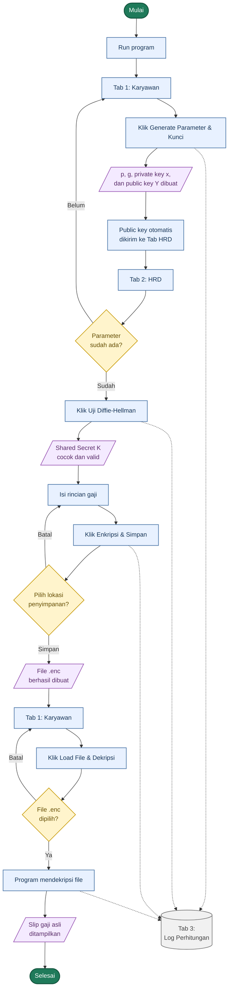

# Sistem Distribusi Slip Gaji yang Terenkripsi (Diffie-Hellman & ElGamal)

Program ini mensimulasikan skenario pembagian dokumen slip gaji antara **HRD** dan **Karyawan** menggunakan **Diffie-Hellman Key Exchange** dan algoritma kriptografi kunci publik **ElGamal**.

Seluruh perhitungan di program ini dibuat dari nol / *from scratch* tanpa import library kriptografi.

---

## Anggota Kelompok
| Nama Lengkap | NRP |
| :--- | :--- |
| Naufal Ardhana | 5027241118 |
| Imam Mahmud Dalil Fauzan | 5027241100 |
| Nabilah Anindya | 5027241006 |

---

## Arsitektur Kode

Kode di dalam program ini dibagi menjadi 3 bagian utama:
- **`SECTION 1: CORE MATH LOGIC`**
  - Berisi fungsi-fungsi aritmetika modulo dasar (`mod_exp`, `is_prime`, `find_primitive_root`, `extended_gcd`, `mod_inverse`).
- **`SECTION 2: DIFFIE-HELLMAN & ELGAMAL CRYPTO LOGIC`**
  - Fungsi inti Diffie-Hellman (`dh_generate_keypair`, `dh_compute_shared_key`) dan algoritma ElGamal (`elgamal_encrypt`, `elgamal_decrypt`).
- **`SECTION 3: GUI & APPLICATION FLOW`**
  - Kode UI yang terbagi ke dalam 3 Tab dan *event handler* untuk eksekusi file `.enc`.

---

## Panduan dan Alur Kerja Program
   ```bash
   # Run Program
   python implemetationElGamal.py
   ```



### Langkah 1: Pembangkitan Parameter & Kunci (Tab 1: Karyawan)
- Setelah di Run, pastikan berada di Tab 1: Karyawan
- Klik tombol "Generate Parameter & Kunci Karyawan (Kirim Public Key ke Tab HRD)", otomatis akan:
    - Membangkitkan bilangan prima acak $p$ dan mencari primitive root $g$.
    - Membangkitkan Private Key Karyawan ($x$) yang disimpan secara rahasia di Tab 1.
    - Menghitung Public Key Karyawan ($Y = g^x \bmod p$) dan mendistribusikan nilai $(p, g, Y)$ secara otomatis ke Tab 2: HRD.

### Langkah 2: Uji Pertukaran Kunci Diffie-Hellman (Tab 2: HRD)
- Pindah ke Tab 2: HRD.
- Pastikan kolom Prima (p), Generator (g), dan Public Key Karyawan (Y) sudah terisi otomatis.
- Klik tombol "Uji Pertukaran Kunci Diffie-Hellman (Hitung Shared Secret K antara HRD & Karyawan)".
- Program akan membangkitkan kunci privat sesi HRD ($y$), menghitung nilai publik HRD ($X = g^y \bmod p$), lalu menghitung Shared Secret Key di kedua sisi:
    - Di sisi HRD: $K = Y^y \bmod p$
    - Di sisi Karyawan (dapat dilihat kembali pada Tab 1): $K' = X^x \bmod p$
    - Kedua nilai $K$ dan $K'$ terbukti bernilai identik tanpa pernah mengirimkan kunci privat melalui jaringan.

### Langkah 3: Enkripsi Rincian Slip Gaji dengan ElGamal (Tab 2: HRD)
- Masih di Tab 2: HRD
- Isi form rincian gaji (Nama Karyawan, NIP, dll.)
- Klik tombol "Enkripsi Slip Gaji dengan ElGamal & Simpan ke File (.enc)".
- Pilih lokasi penyimpanan file
- Setiap karakter teks slip gaji diubah menjadi nilai ASCII $m$ dan dienkripsi menggunakan ephemeral key acak $k$ menjadi pasangan ciphertext $(a, b)$ di mana:
    - $a = g^k \bmod p$
    - $b = (Y^k \cdot m) \bmod p$

### Langkah 4: Dekripsi File Slip Gaji .enc (Tab 1: Karyawan)
- Kembali ke Tab 1: Karyawan.
- Klik tombol "Load File Slip Gaji (.enc) & Dekripsi Sekarang".
- Pilih file `slip_gaji_elgamal.enc` yang telah disimpan oleh HRD tadi.
- Program akan membaca setiap pasangan $(a, b)$ dan memulihkan teks asli menggunakan Private Key Karyawan ($x$):
    - Menghitung shared mask $s = a^x \bmod p$
    - Mencari modular inverse $s^{-1} \bmod p$
    - Menghitung $m = (b \cdot s^{-1}) \bmod p$ dan mengubahnya kembali menjadi teks slip gaji utuh di layar.

## Log Perhitungan
- Terdapat **Tab 3: Log Perhitungan**.
- Seluruh history perhitungan matematika mulai dari awal, hingga sampel perhitungan enkripsi dan dekripsi ElGamal per karakter tercacat disini.


## Fitur

1. **Pure Mathematical Implementation (Tanpa Import Library Kriptografi):**
   - *Modular Exponentiation* (`Square-and-Multiply Algorithm`)
   - *Primality Testing* & *Prime Factorization*
   - *Automated Primitive Root (Generator $g$) Finder*
   - *Extended Euclidean Algorithm* & *Fermat's Little Theorem* untuk *Modular Multiplicative Inverse*
2. **Terdapat 3 Tab:**
   - **Tab 1: Karyawan** — Pembangkitan parameter domain $(p, g)$, pembuatan pasangan kunci (*Public Key* & *Private Key*), verifikasi *Shared Secret Key* Diffie-Hellman, serta dekripsi file slip gaji (`.enc`).
   - **Tab 2: HRD** — Simulasi *Diffie-Hellman Key Exchange Handshake*, pengisian form rincian gaji karyawan, serta enkripsi *probabilistic* ElGamal ke dalam file `.enc`.
   - **Tab 3: Log Perhitungan** — Transparansi alur perhitungan matematika step-by-step.
